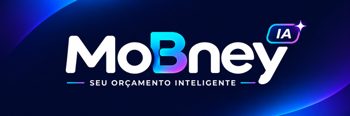
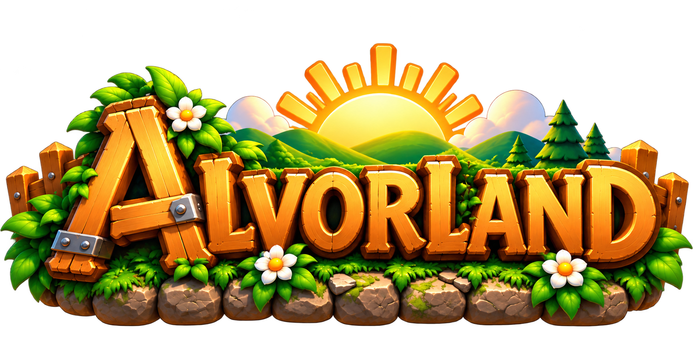

# 🚀 Portfólio · Sidney Filho

Vitrine pública de projetos autorais, arquitetura de produto, ferramentas de desenvolvimento e jogos.

---

## 📌 Projetos em Destaque

<table>
  <tr>
    <td align="center" width="50%">
      
       
      <strong>SpecBoard</strong>
      
Gestão visual de projetos e especificações (Spec-Driven Development).

      <a href="https://github.com/sidneyfilho/SpecBoard">🔗 Ver Repositório</a>
    </td>
    <td align="center" width="50%">
      
       
      <strong>Mobney</strong>
      
Gestão financeira pessoal inteligente (Vue 3, Vuetify 3, Cordova & Spring Boot).

      <a href="./mobney">🔗 Ver Vitrine do Projeto</a>
    </td>
  </tr>
  <tr>
    <td align="center" width="50%">
      
       
      <strong>Alvorland</strong>
      
Game 3D de vida na fazenda e RPG com mundo virtual (Godot 4.7 & Blender).

      <a href="./alvorland">🔗 Ver Vitrine do Projeto</a>
    </td>
    <td align="center" width="50%">
      
       
      <strong>Asset Studio 3D</strong>
      
Criação de mapas, gerenciamento de assets 3D e sincronização com Godot.

      <a href="https://github.com/sidneyfilho/asset-studio-3d">🔗 Ver Repositório</a>
    </td>
  </tr>
</table>

---

## 📂 Estrutura deste Repositório

Para manter os repositórios de produção, código-fonte e assets brutos privados (`doc-mobney`, `doc-alvorland`, etc.), este repositório público reúne a documentação de vitrine e as capturas de tela dos projetos fechados:

- **[`mobney/`](./mobney/README.md)** — Visão do produto, identidade visual, telas do app, arquitetura e estrutura de backlog do **Mobney**.
- **[`alvorland/`](./alvorland/README.md)** — Visão do jogo, capturas de tela, pipeline 3D (Blender/Meshy/Asset Studio 3D → Godot) e especificações do **Alvorland**.

---

Conteúdo © Sidney Filho · Todos os direitos reservados.

