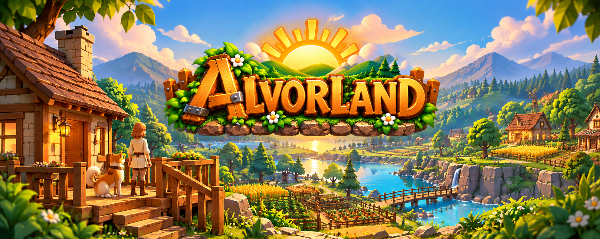
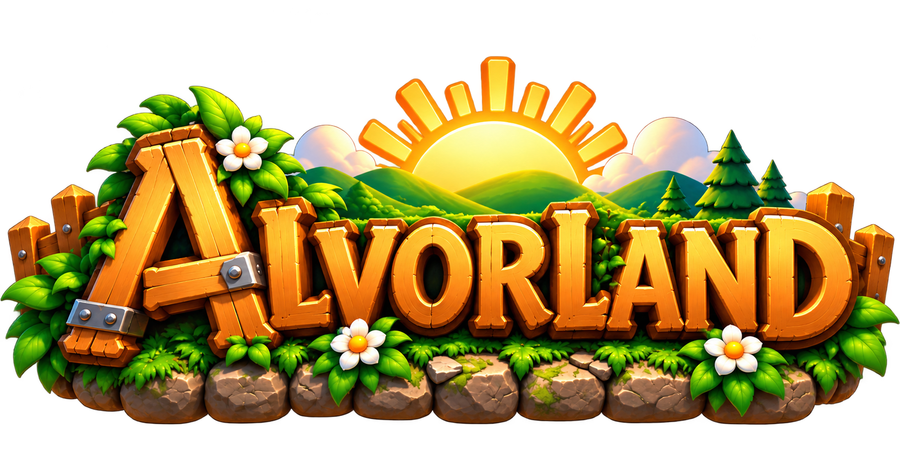
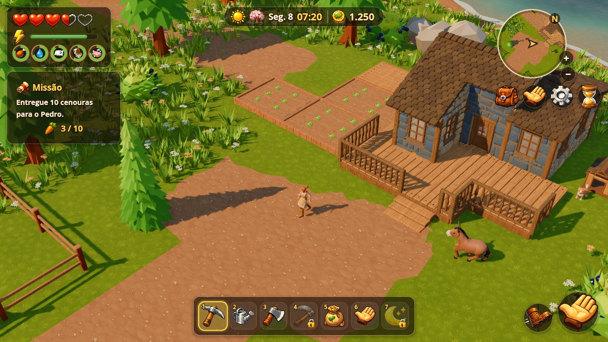
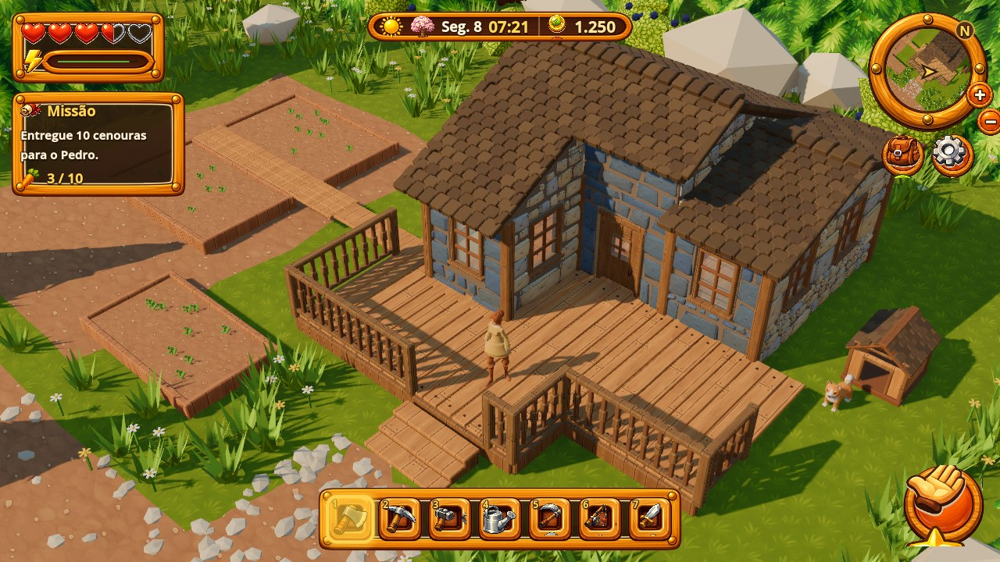
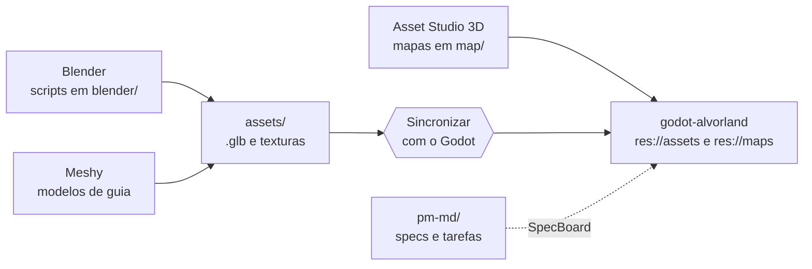

<div align="center">



<br>



### Uma fazenda, uma cidade e um pôr do sol para chamar de seu.


</div>

---

## O jogo

**Alvorland** é um jogo 3D de vida na fazenda com progressão de RPG, no espírito de Stardew Valley: ciclo de dias, estações, necessidades da personagem, plantio, animais e vizinhança. A câmera é fixa, vista de cima, e o visual é um low-poly pintado, com modelos montados a partir de peças modulares.

- **Fazenda solo:** casa, quintal, plantações, lago, o cachorro Akita e a mula, que segue e pode ser montada.
- **Cidade Central de Alvorland:** a estrada oeste da fazenda leva à cidade, com restaurantes, cafeteria, pousada, hospital, casa do prefeito, mercado global (10% de taxa) e uma feira ao ar livre em datas especiais (sem taxa). Funciona como hub social de roleplay, em instâncias de até 100 jogadores (meta ainda em validação).
- **Economia fechada:** dinheiro de verdade compra acesso, nunca moedas nem itens.
- **PC e Android:** toda função tem entrada por teclado e por toque.

<div align="center">
  
  
</div>

---

## Pipeline de produção

O repositório privado de produção (**doc-alvorland**) concentra a origem de tudo o que o jogo usa: modelos, texturas, mapas, scripts do Blender e o backlog do projeto. O projeto Godot (`godot-alvorland`) recebe a sincronização pelo [**Asset Studio 3D**](https://github.com/sidneyfilho/asset-studio-3d) (botão **Sincronizar com o Godot**).



---

## Estrutura de produção (`doc-alvorland`)

```
assets/        modelos .glb e texturas que vão para o jogo (res://assets/ no Godot)
  buildings/       construções
    house/           peças da casa e do quintal: paredes, frente, telhado, porta, alpendre, interior, casinha, canteiros, chão
    kit/             kit modular próprio (casa nível 2: wall, roof_slope, porch_deck...)
  furniture/       móveis: bed, table, chair, chest, rug
  plants/          pine_a..c, tree_a..c, bush_a..c, grass_a/b, flower_w/y (um modelo por tipo, com variações; o mapa usa cópias)
  rocks/           rock_a..c, pebble_a/b
  characters/      personagens (camponesa, KayKit) e roupas/ferramentas (outfit/)
  animals/         cachorro Akita (Idle, Walk, LieDown e Lie) e a mula
  tex/             texturas pintadas
map/           mapas do Asset Studio 3D (*.map.json) -> res://maps/<nome>.tscn
blender/       scripts do Blender que geram os modelos (gravam em assets/); ref_scene.glb é a cena inteira da casa, que
               godot-alvorland/tools/split_scene.gd separa em assets/buildings/house, furniture, plants e rocks
ref/           imagens de referência, modelos de guia (Meshy) e os kits da Kenney (ref/kenney: town e nature, CC0); não vão para o jogo
tools/         ferramentas de apoio de IA (gpt_image.mjs gera imagens 2D; meshy.mjs gera modelos 3D em .glb)
ui/            logo, capa e folhas de interface (botões, painéis, ícones)
pm-md/         gestão do projeto: specs, planos e tarefas lidos pelo SpecBoard (veja abaixo)
docs/img/      capturas de tela usadas neste README
alvorland-studio.json   configuração do Asset Studio 3D
```

---

## Gestão do projeto ([SpecBoard](https://github.com/sidneyfilho/SpecBoard))

O backlog vive em Markdown e YAML dentro de `pm-md/` (repositório privado) e é gerenciado pelo **SpecBoard**.

| Spec | Tema | Estado |
|---|---|---|
| SPEC-001 | Fundação e pipeline de assets | em andamento |
| SPEC-002 | Mundo e mapa | em andamento |
| SPEC-003 | Personagem e roupas | em andamento |
| SPEC-004 | HUD, necessidades e inventário | em andamento |
| SPEC-005 | Cachorro companheiro | em andamento |
| SPEC-006 | Mobile (Android) | em andamento |
| SPEC-007 | Jogabilidade e progressão | planejamento |
| SPEC-008 | Cidade Central e Hub Social (RP) | planejamento |
| SPEC-009 | Montaria (mula) | planejamento |

Cada spec tem `spec.md` (requisitos e critérios de aceite), `plan.md` (abordagem técnica) e `tasks.md` (tarefas com status, prioridade, dependências e arquivos), acompanhados por `pm-md/ROADMAP.md` e `pm-md/AGENTS.md`.

---

## Diretrizes técnicas da pipeline

1. **Fonte única de verdade:** `assets/` e `maps/` do Godot são gerados automaticamente pela sincronização com o `doc-alvorland`.
2. **Repositório limpo:** artefatos gerados pelo importador do Godot (`.import` e texturas extraídas dos `.glb`) não são versionados.
3. **Texturas compartilhadas em `assets/tex/`:** JPG para texturas pintadas e PNG apenas quando há transparência; os `.glb` referenciam as texturas sem duplicá-las.
4. **Modelagem procedural/scriptada:** scripts Python do Blender em `blender/` geram os kits modulares diretamente em `assets/`.
5. **Licenciamento:** apenas conteúdo próprio ou CC0 documentado em `LICENSE_*.txt`.
6. **Localização:** todos os textos visíveis ao jogador em português do Brasil.

---

## Ferramentas do projeto

| Para quê | Ferramenta |
|---|---|
| Motor do jogo | Godot 4.7 (Forward+) |
| Modelos modulares e cenas | Blender, por scripts em `blender/` |
| Personagens e animais de guia | Meshy (`tools/meshy.mjs`) |
| Imagens 2D de apoio | `tools/gpt_image.mjs` |
| Mapas e sincronização | [Asset Studio 3D](https://github.com/sidneyfilho/asset-studio-3d) |
| Backlog | [SpecBoard](https://github.com/sidneyfilho/SpecBoard) lendo `pm-md/` |
| Servidor do modo online (planejado) | Java com Spring Boot, REST + WebSocket e PostgreSQL |

---

## Créditos e licenças

| O quê | Origem | Licença |
|---|---|---|
| `ref/kenney/nature`, `ref/kenney/town` | [Kenney](https://www.kenney.nl) (Nature Kit, Fantasy Town Kit) | CC0 |
| `assets/characters/Mage.glb`, `Rogue.glb` | [KayKit Adventurers](https://kaylousberg.com) (Kay Lousberg) | CC0 |
| Base da camponesa (`farmer_umw.glb`) | Ultimate Modular Women, [Quaternius](https://quaternius.com) | CC0 |
| Casa, kit modular, móveis, plantas e pedras | gerados pelos scripts de `blender/` | próprio |
| Logo, capa, `ui/gpt/`, ícones de `assets/ui/` e texturas pintadas de `assets/tex/` | gerados com IA (OpenAI, via `tools/gpt_image.mjs`) e editados | próprio |
| Modelos de guia em `ref/meshy/` e o cachorro/mula de `assets/animals/` | gerados com IA ([Meshy](https://www.meshy.ai), via `tools/meshy.mjs`) | próprio (licença comercial do Meshy) |
| Imagens de referência em `ref/` | geradas com IA ou licenciadas | uso licenciado |

O conteúdo próprio deste projeto (código, scripts, specs e arte) está publicado como portfólio: **todos os direitos reservados**. Os pacotes CC0 acima seguem a licença original.

---

<div align="center">

<sub><a href="../README.md">← Voltar ao Portfólio</a></sub>

*Feito com calma, uma peça de cada vez.* 🌅

</div>
