<div align="center">


# Mobney · Documentação e gestão do produto

**Planejamento, design e backlog do Mobney, o app pessoal de orçamento que abre direto na Home e só pede conta depois que você já viu valor.**


</div>

---

## O que é o Mobney

O Mobney é um app de orçamento pessoal em português do Brasil: você lança entradas e saídas, define limites por categoria, forma de pagamento e despesa fixa, e acompanha o mês numa Home que mostra o que importa (gasto × previsto, saldo, próximos vencimentos).

Esta página apresenta a **vitrine pública de documentação e produto** do projeto: visão, identidade visual, telas, arquitetura e organização do backlog (SpecBoard). Os repositórios de código e artefatos internos são privados.

<div align="center">

</div>

## Telas

O design system novo (tema `mobneyLight`, componentes `Mb*`, fonte Inter) já está em **todas** as telas do app.

### Uso diário

<div align="center">
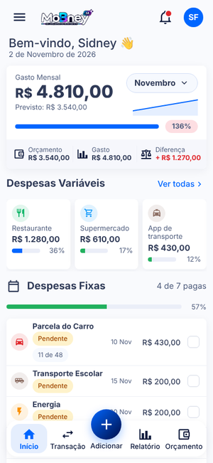
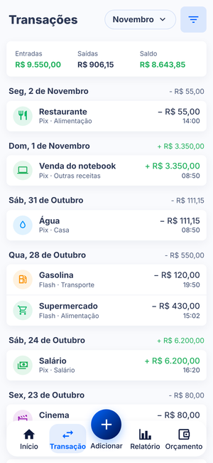
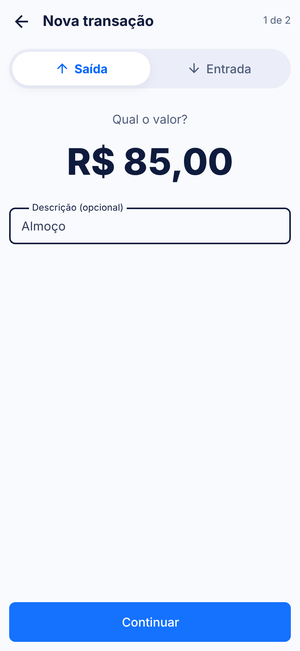
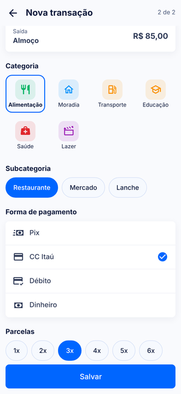
</div>

<div align="center">
<sub>Home · Transações · Nova transação (valor) · Nova transação (categoria e pagamento)</sub>
</div>

### Planejamento

<div align="center">
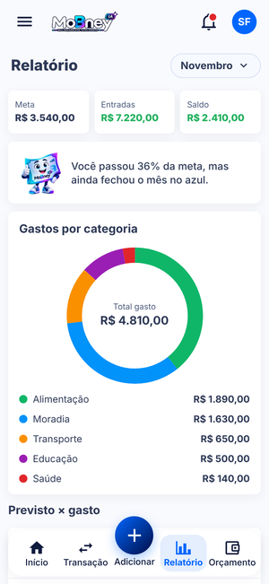
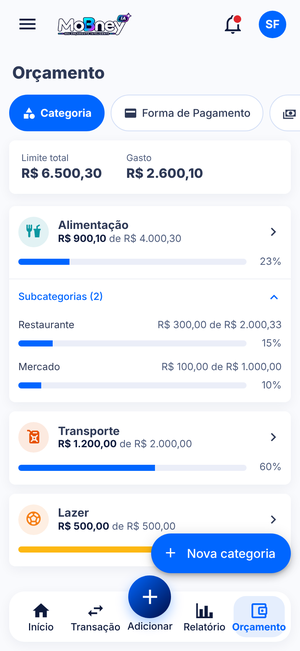
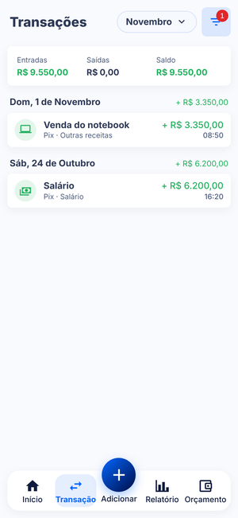
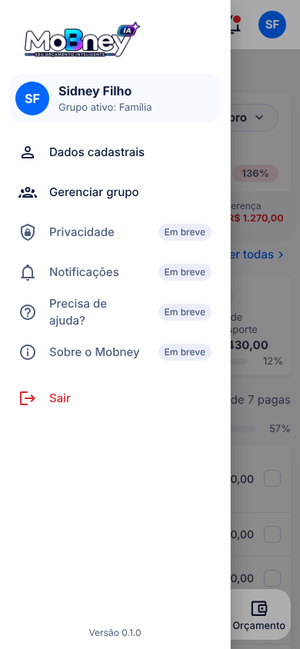
</div>

<div align="center">
<sub>Relatório · Orçamento · Filtro de transações · Menu lateral</sub>
</div>

### Entrada e uso sem conta

O app abre direto na Home (modo convidado). A criação de conta é sugerida mais tarde, com os dados locais migrados para ela.

<div align="center">
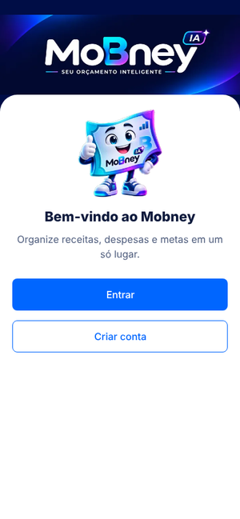
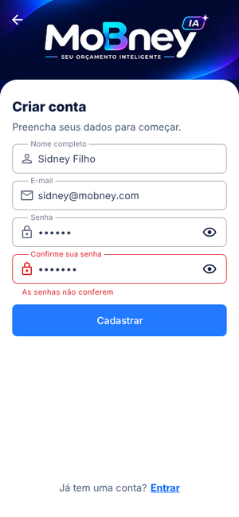
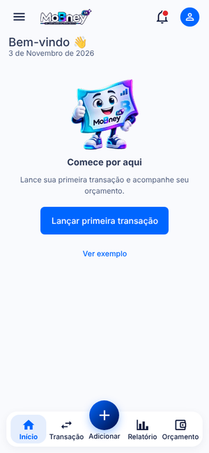

</div>

<div align="center">
<sub>Start · Cadastro · Home no primeiro uso · Convite para criar conta</sub>
</div>

## Identidade visual

| Token | Valor | Uso |
|---|---|---|
| Primária | `#0066FF` | ações, item ativo, destaques |
| Fundo | `#F9FAFD` | fundo das telas internas |
| Texto | `#0F1B3D` / `#4F5D7D` | principal / secundário |
| Positivo | `#22B15E` | entradas, pago |
| Alerta | `#FDB813` | atenção |
| Negativo | `#E0262B` | saídas acima do limite, vencido |
| Marca | `#000D46` · `#00C4F0` · `#9B1EB4` | fundo navy, ciano, magenta da marca |

Cantos de 16 dp, barras de progresso de 8 dp, margem lateral de 12 dp e 24 dp entre blocos. Barra inferior com 5 posições e o botão **Adicionar** elevado no centro.

<div align="center">

</div>

## Arquitetura prevista

```
┌────────────────┐   REST    ┌────────────────────┐
│  mobile-mobney │ ────────► │  backend "atom"    │
│  Vue 3 + TS    │           │  Spring Boot + PG  │
│  Vuetify 3     │ ◄──────── │  (planejado)       │
└───────┬────────┘           └────────────────────┘
        │ Cordova
   ┌────▼───────┐
   │ Android APK│
   └────────────┘
```

Hoje os dados vivem no próprio aparelho (`FinancasStore` em localStorage, atrás de repositórios com interface + mock), o que permite trocar pelo backend sem reescrever as telas.

## Backlog ([SpecBoard](https://github.com/sidneyfilho/SpecBoard))

O trabalho é planejado em Specs, cada uma com `spec.md`, `plan.md` e `tasks.md` em `pm-md/specs/` (no repositório privado de documentação).

| Spec | Tema | Tarefas |
|---|---|---|
| SPEC-001 | Fundação do build e segurança | T001–T005 |
| SPEC-002 | Design system e marca | T006–T010, T040, T041 |
| SPEC-003 | Nova Home | T011–T017 |
| SPEC-004 | Modernização das demais telas | T018–T024, T042–T046 |
| SPEC-005 | Backend atom (Spring Boot) | T025–T032 |
| SPEC-006 | Integração do app com o atom | T033–T039 |
| SPEC-007 | Uso sem conta (convidado primeiro) | T047–T053 |

Regras do fluxo: quem executa leva a tarefa até `review`, nunca `done`; só o PM fecha (documentado em `pm-md/AGENTS.md`, `pm-md/.specboard/constitution.md` e `pm-md/ROADMAP.md`).

## Repositórios do projeto (privados)

- `doc-mobney`: documentação completa, backlog SpecBoard, prompts e ferramentas de geração de telas
- `mobile-mobney`: app Vue 3 + Vuetify 3
- `cordova-mobney`: empacotamento Android
- `spring-atom-mobney`: backend Spring Boot + MariaDB (em construção, SPEC-005)

## Sobre esta vitrine

Esta página reúne a apresentação pública de produto do **Mobney**, mostrando como o produto é planejado e desenhado: visão, identidade visual, telas, arquitetura e backlog em Specs.

Conteúdo © Sidney Filho. Todos os direitos reservados.

---

<div align="center"><sub><a href="../README.md">← Voltar ao Portfólio</a> · Feito com carinho por Sidney · Mobney IA — Seu orçamento inteligente</sub></div>
